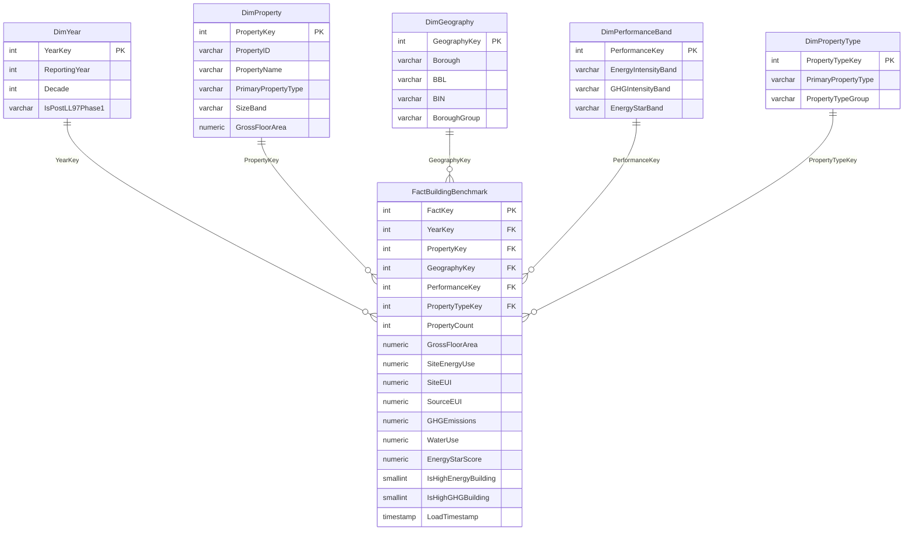
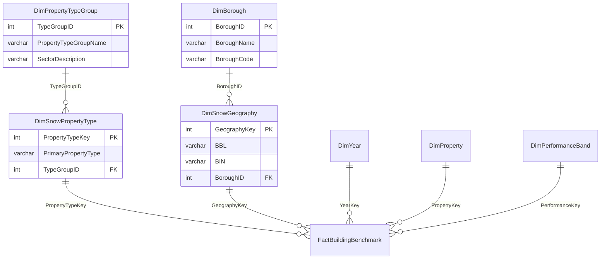
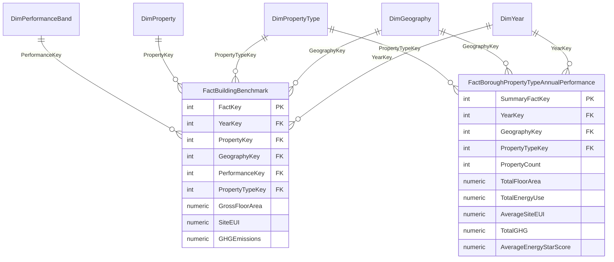

# Dimensional Modelling Design & Comparative Evaluation
## NYC Building Energy and Sustainability Analytics Data Warehouse (Local Law 84)

---

## 1. Grain Declaration
> **Formal Grain:** *One row in `FactBuildingBenchmark` represents the annual benchmarking disclosure of one covered building property for one calendar reporting year.*

This grain ensures atomic reporting fidelity:
- Properties report annually under NYC Local Law 84.
- Energy and emissions metrics are aggregated over exactly 12 months.
- No mixed grains exist in the central fact table.

---

## 2. Model 1: Star Schema (Recommended Final Model)

The Star Schema provides the highest query simplicity and BI dashboard performance by denormalizing dimensional hierarchies directly into dimension tables.

---

## 3. Model 2: Snowflake Schema

In the Snowflake Schema, dimensional hierarchies (such as Property Type categories and Geographic jurisdictions) are normalized into 3NF lookup tables to eliminate redundant category strings.

---

## 4. Model 3: Fact Constellation Schema

The Fact Constellation contains multiple fact tables sharing conformed dimensions. In this architecture, a second aggregate fact table (`FactBoroughPropertyTypeAnnualPerformance`) enables ultra-fast municipal policy reporting without aggregating millions of individual building records.

---

## 5. Architectural Comparison Across 8 Prescribed Criteria

| Evaluation Criterion | Star Schema | Snowflake Schema | Fact Constellation |
|---|---|---|---|
| **1. Number of Tables** | Minimal (1 Fact + 5 Dims = 6) | Higher (1 Fact + 8-10 normalized Dims) | Highest (2+ Facts + 5 Conformed Dims) |
| **2. Number of Joins** | Exactly 1 join per dimension (star join) | Multiple chained joins (e.g., Fact -> Type -> Group) | Single join for aggregate fact; star join for detailed fact |
| **3. Storage Redundancy** | Moderate (category text repeated in dims) | Minimal (3NF normalization removes text redundancy) | Low (summary fact saves compute vs storage) |
| **4. Query Complexity** | Very Low (straightforward `JOIN ... ON`) | Higher (complex multi-hop foreign keys) | Dual-level (easy for aggregate BI, detailed when required) |
| **5. BI / Dashboard Simplicity** | **Best** (intuitive drag-and-drop in Power BI) | Poor (users must navigate snowflake hierarchies) | High (dashboards connect directly to pre-aggregated marts) |
| **6. Maintainability** | High (simple schema migrations) | Lower (cascading updates across hierarchy tables) | Moderate (must maintain aggregate load routines) |
| **7. Performance** | **Fastest** for analytical OLAP scans | Slower due to join overhead on large scans | Fastest for municipal summaries; equal for atomic scans |
| **8. Hierarchy Management** | Attributes embedded in single dimension | Strict relational hierarchy enforcement | Conformed dimensions bridge granular & aggregate facts |

---

## 6. Final Model Selection & Academic Justification

### Selected Model: **Star Schema with Aggregate Fact Constellation Bridge**
- **Justification:**
  1. **Analytical Performance:** In modern columnar and indexed relational stores (PostgreSQL / Citus / ClickHouse), join overhead is the primary query bottleneck. The Star Schema minimizes foreign-key traversals, allowing vector execution engines and OLAP grouping sets (`ROLLUP`, `CUBE`) to maximize cache locality.
  2. **Power BI / Semantic Layer Compatibility:** Business intelligence front-ends (Power BI, Tableau) function with optimal DAX filter-context propagation when connected to a pure Star Schema. Snowflake relationships introduce bidirectional cross-filtering ambiguities.
  3. **Analytical Mart Generation:** Generating downstream data-mining marts (`building_performance_analytics_mart`) requires flat denormalized vectors for Scikit-learn and mlxtend. The Star Schema matches this lifecycle without multi-table relational reconstruction.
